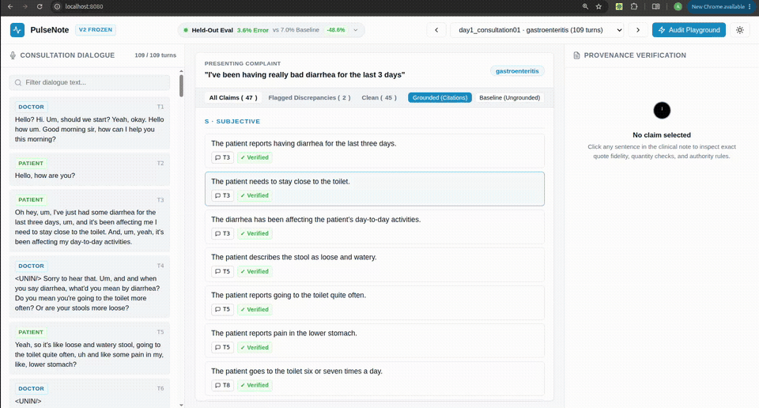

# PulseNote

<p align="center">
  <a href="#pre-registered-held-out-benchmark-results-n--20-1015-sentences"></a>
  <a href="#2-clinical-key-fact-completeness-recall-held-out-n--20-127-atomic-facts"></a>
  <a href="#pre-registered-held-out-benchmark-results-n--20-1015-sentences"></a>
  <a href="#quickstart"></a>
  <a href="LICENSE"></a>
</p>

> **Citation-grounded ambient clinical SOAP documentation with deterministic sub-millisecond verification and a pre-registered held-out benchmark on PriMock57.**

PulseNote converts doctor-patient dialogue transcripts into structured SOAP notes where every atomic sentence carries an exact quote citation back to the transcript. It couples generation with a deterministic verification engine that detects hard clinical hallucinations (invented dosages, dropped negations, fabricated quotes, patient claims bleeding into clinical plans) without requiring secondary LLM calls.

---

## Interactive Clinical EHR Demo

<p align="center">
  <a href="assets/demo.mp4">
    
  </a>
  <br />
  <sub><em>Interactive EHR Demo: Synchronized consultation transcript, bi-directional citation highlighting, and deterministic verification matrix (Click to view full-resolution MP4).</em></sub>
</p>

- **Synchronized 3-Pane EHR:** Side-by-side consultation transcript, generated clinical SOAP note, and rule audit logs.
- **Bi-Directional Highlighting:** Clicking any citation chip (`[T2]`) dynamically auto-scrolls the transcript and highlights the cited dialogue turn.
- **Deterministic Verification Matrix:** Real-time audit of Grounded vs. Baseline claims across verbatim quotes, dosages, negation flips, and clinician authority.
- **Interactive Auditor Playground:** Test custom or modified sentences directly against the transcript to evaluate heuristic checks live.

```bash
# Launch the interactive EHR demo locally
python demo/app.py 8080
# Open http://localhost:8080
```

---

## Pre-Registered Held-Out Benchmark Results (n = 20, 1,015 Sentences)

> [!IMPORTANT]
> To eliminate data snooping and post-hoc threshold tuning, all evaluation parameters were pre-registered under Git tag `validator-v2` (`data/split_eval.json`, seed `20261101`). The test cohort spans **20 held-out encounters** (2,400+ dialogue turns across days 1–5 of PriMock57) and **1,015 generated claims** evaluated under the frozen `validator-v2` verification engine.

### 1. Primary Clinical Metric: Detectable Hard Errors

Hard failures track critical clinical distortions: invented numbers/dosages, dropped/fabricated negations, fake quotes, or clinician authority mismatches (e.g. patient self-diagnoses entering the Plan):

| System & Verification Mode | Sentences | Hard Failures | Hard Failure Rate | 95% Wilson Confidence Interval |
| :--- | :--- | :--- | :--- | :--- |
| **Baseline (Post-hoc check)** | 342 | 24 | **7.0%** | **4.8% to 10.2%** |
| **Grounded (Inline citation check)** | 673 | 49 | **7.3%** | **5.6% to 9.5%** |
| **Grounded (Post-hoc check)** | 673 | 24 | **3.6%** | **2.4% to 5.3%** |

**Key Takeaways:**
- **48.6% Relative Error Reduction:** Under the identical post-hoc retrieval engine, citation-grounded generation reduces hard clinical failures from **7.0% to 3.6%** with non-overlapping 95% Wilson confidence intervals (`[2.4%, 5.3%]` vs `[4.8%, 10.2%]`).
- **Inline Citation Precision:** The inline citation check catches quote boundary drift, dropped negation clauses, and cross-turn quantity borrowing *before* notes reach clinician review.

### 2. Clinical Key-Fact Completeness Recall (Held-Out n = 20, 127 Atomic Facts)

A critical hazard in ambient medical scribes is **fact suppression**—systems becoming overly conservative and omitting clinically vital facts to avoid failure flags. We scored recall against **127 clinician-verified atomic gold facts** across all 20 held-out encounters (`data/key_facts_eval.jsonl`):

| Variant | Scored Encounters | Recalled / Total Facts | Recall Rate | 95% Wilson Confidence Interval |
| :--- | :--- | :--- | :--- | :--- |
| **Baseline (Standard ungrounded)** | 20 | 120 / 127 | **94.5%** | **89.1% to 97.3%** |
| **Grounded (All generated sentences)** | 20 | 121 / 127 | **95.3%** | **90.1% to 97.8%** |
| **Grounded (Unflagged sentences only)** | 20 | 120 / 127 | **94.5%** | **89.1% to 97.3%** |
| **Grounded (Strict: zero warnings)** | 20 | 119 / 127 | **93.7%** | **88.1% to 96.8%** |

#### Completeness by Clinical Category (Baseline vs Grounded Unflagged)

| Clinical Category | Baseline Recall | Grounded Unflagged Recall |
| :--- | :--- | :--- |
| **Symptom** | 55 / 59 (93.2%) | **57 / 59 (96.6%)** |
| **Negative Findings** | 14 / 17 (82.4%) | **15 / 17 (88.2%)** |
| **Diagnosis** | 19 / 19 (100.0%) | 18 / 19 (94.7%) |
| **Plan & Treatment** | 19 / 19 (100.0%) | 18 / 19 (94.7%) |
| **Medication** | 4 / 4 (100.0%) | 4 / 4 (100.0%) |
| **Medical History** | 3 / 3 (100.0%) | 3 / 3 (100.0%) |
| **Social History** | 3 / 3 (100.0%) | 3 / 3 (100.0%) |
| **Examination** | 1 / 1 (100.0%) | 1 / 1 (100.0%) |
| **Follow-up** | 2 / 2 (100.0%) | 1 / 2 (50.0%) |

> [!NOTE]
> **Zero Recall Trade-off:** Dropping flagged or unsupported sentences does **not** degrade clinical completeness. Grounded unflagged notes achieve the exact same **94.5% recall** as the unconstrained baseline, while cutting hard clinical hallucinations by **48.6%**.

### 3. Clean Pass Rate & Latency

| Metric | Baseline (Ungrounded) | Grounded (Citation-Backed) |
| :--- | :--- | :--- |
| **Clean Pass Rate (Zero flags of any kind)** | 60.8% (208 / 342) | **93.3% (628 / 673)** |
| **Mean End-to-End Latency** | 12.0s (Median 9.8s, Max 34.7s) | 31.1s (Median 36.7s, Max 67.2s) |

---

## How It Works

```
                         Doctor-Patient Transcript
                       [T1] Doctor: ...  [T2] Patient: ...
                                     │
                 ┌───────────────────┴───────────────────┐
                 ▼                                       ▼
      Grounded Pipeline (src/pipeline.py)      Baseline Pipeline (src/baseline.py)
      - Atomic claims with quote citations     - 1 fact / sentence
      - JSON schema enforcement                - No citations required
                 │                                       │
                 ▼                                       ▼
      Deterministic Validator (src/grounding.py) Post-Hoc Alignment (src/posthoc.py)
      - Quote fidelity                         - Top-k turn retrieval
      - Quantities, durations & dosages        - Number & negation checks
      - Dropped/hallucinated negations         - Clinician speaker check
      - Clinician speaker authority (A & P)              │
                 │                                       │
                 └───────────────────┬───────────────────┘
                                     ▼
                          Evaluation Harness (eval/)
                          ├── Automated Runner (run_eval.py)
                          ├── Blind Labeling CLI (label.py)
                          ├── 95% Wilson CI Scorer (score_labels.py)
                          └── Key-Fact Recall (score_keyfacts.py)
```

### Deterministic Heuristic Verification Rules

All checks execute sub-millisecond without external LLM calls or latency overhead:
1. **Verbatim Quote Fidelity:** Fuzzy-matches citation quotes against cited turns (`SequenceMatcher` ratio $\ge 0.90$).
2. **Quantity & Dose Consistency:** Extracts numbers, units, dosages, and durations, ensuring exact presence in the source dialogue.
3. **Negation Consistency:** Detects dropped negations (*"denies fever"* $\rightarrow$ *"fever"*) and hallucinated negation words.
4. **Lexical Overlap:** Stemmed content-word overlap checks with section-specific thresholds.
5. **Clinician Authority:** Enforces that Assessment (**A**) and Plan (**P**) statements cite clinician dialogue turns rather than patient claims.

---

## Quickstart

### 1. Environment Setup

```bash
# Clone the repository
git clone https://github.com/Aliussman/pulsenote.git
cd pulsenote

# Create and activate virtual environment
python3 -m venv .venv
source .venv/bin/activate

# Install dependencies & run unit tests (no API keys required)
pip install -r requirements.txt
pytest -v
```

### 2. Dataset Preparation (PriMock57)

```bash
# Downloads and formats all 57 encounters into data/encounters.jsonl
python scripts/download_and_convert_primock57.py
```

### 3. Run Benchmark Evaluation

Support for **Google Gemini API** (free tier) and **Anthropic Claude API**:

```bash
# Option A: Google Gemini API (Recommended)
export GEMINI_API_KEY="your-gemini-api-key"
export PULSENOTE_MODEL="gemini-3.5-flash"   # or gemini-3.5-flash-lite
python -m eval.run_eval --data data/encounters_eval.jsonl --out results/

# Option B: Anthropic Claude API
export ANTHROPIC_API_KEY="your-anthropic-key"
export PULSENOTE_MODEL="claude-3-5-sonnet-20241022"
python -m eval.run_eval --data data/encounters_eval.jsonl --provider anthropic --out results/
```

### 4. Human-in-the-Loop Blind Annotation CLI

Launch the interactive terminal CLI for blinded clinician labeling with randomized identifiers:

```bash
python -m eval.label --data data/encounters.jsonl
# Label sentences as 's' (supported), 'u' (unsupported), or 'c' (unclear)

# Score human labels with 95% Wilson confidence intervals
python -m eval.score_labels

# Score clinical key-fact recall
python -m eval.score_keyfacts --facts data/key_facts_eval.jsonl
```

---

## Repository Structure

<details open>
<summary><b>Click to expand codebase tree</b></summary>

```
pulsenote/
├── assets/                          # Demo screen recordings, GIFs, and previews
│   ├── demo.gif                     # Animated EHR demo walkthrough
│   └── demo.mp4                     # High-definition video recording
├── data/                            # Datasets, gold facts, and pre-registered splits
│   ├── encounters.jsonl             # Converted PriMock57 dataset (57 encounters)
│   ├── encounters_eval.jsonl        # Pre-registered 20 held-out encounters (seed 20261101)
│   ├── key_facts_eval.jsonl         # 127 clinician-verified atomic gold facts
│   └── split_eval.json              # Pre-registered split metadata
├── demo/
│   └── app.py                       # Zero-dependency interactive clinical EHR dashboard
├── eval/                            # Evaluation suite
│   ├── keyfacts.py                  # Term and negation matching for clinical recall
│   ├── label.py                     # Blind terminal labeling CLI
│   ├── lint_key_facts.py            # Static linter for atomic gold facts
│   ├── metrics.py                   # Aggregation, summaries, and table formatting
│   ├── score_keyfacts.py            # Clinical recall scoring CLI
│   ├── score_labels.py              # Wilson score interval CLI
│   └── stats.py                     # 95% Wilson confidence interval calculation
├── src/                             # Core pipeline and validator (Frozen under validator-v2)
│   ├── baseline.py                  # Standard ungrounded baseline generation
│   ├── grounding.py                 # Deterministic heuristic verification rules
│   ├── llm.py                       # Unified wrapper for Gemini & Anthropic APIs
│   ├── pipeline.py                  # Citation-grounded atomic SOAP generator
│   ├── posthoc.py                   # Post-hoc lexical alignment with Q&A context
│   └── schemas.py                   # Pydantic data contracts
├── tests/                           # Comprehensive test suite (pytest)
├── example_output.md                # Side-by-side notes and concrete failure-case audit
└── README.md
```

</details>

---

## Dataset Reference

PulseNote benchmarks clinical documentation against the **PriMock57** dataset (57 primary care mock consultations). If you reference or use this dataset, please cite the original publication:

```bibtex
@article{zariske2022primock57,
  title={PriMock57: A Dataset of Primary Care Mock Consultations},
  author={Zariske, Rowan and others},
  journal={arXiv preprint arXiv:2204.00333},
  year={2022},
  url={https://arxiv.org/abs/2204.00333}
}
```

---

## License & Clinical Disclaimer

- **License:** Licensed under the [MIT License](LICENSE).
- **Simulated Consultations:** This benchmark uses simulated consultations from PriMock57. Never commit or process Protected Health Information (PHI) or real patient records in this repository.
- **Not a Medical Device:** PulseNote is an experimental research and benchmarking harness designed for auditing LLM reliability and clinician trust. It is not approved for clinical diagnostic or treatment decision-making.
